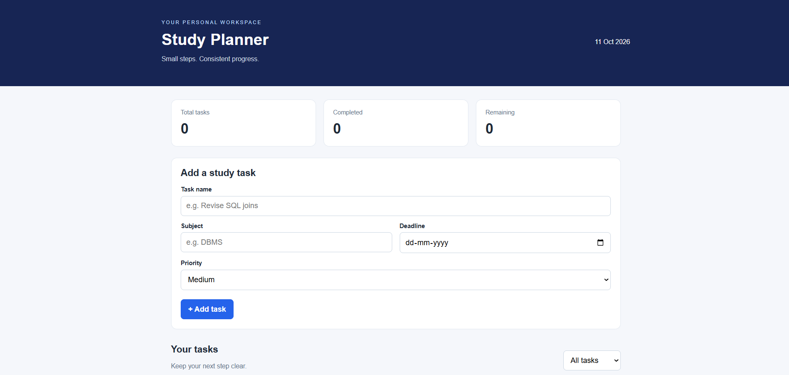

# Student Study Planner

A simple, responsive study planner built to help students organize
their academic tasks, manage deadlines, and track their progress.

## Features

- Add study tasks with subjects, deadlines, and priorities
- Mark tasks as completed or pending
- Delete tasks
- Filter tasks by completion status
- View task statistics
- Save tasks in the browser using localStorage
- Responsive layout for desktop and mobile

## Technologies Used

- HTML5
- CSS3
- JavaScript
- Browser localStorage

## How to Run

1. Clone or download this repository.
2. Open the project folder in VS Code.
3. Open `index.html` using the Live Server extension.

## What I Learned

This project helped me practice structuring a website with HTML,
styling it with CSS, handling user interactions with JavaScript,
and storing data in the browser.

## Future Improvements

- Edit existing tasks
- Add search and subject filters
- Add calendar and study progress views
- Build a backend and database

---

Created as a personal learning project.

## Screenshot

## Live Demo

Try the [Student Study Planner](https://shreyasnarkar-23.github.io/student-study-planner/).

## Project Structure

- `index.html` — page structure and task form
- `style.css` — styling and responsive layout
- `script.js` — task management and browser storage
- `screenshots/` — project screenshots

## Future Improvements

- Edit existing tasks
- Search and filter tasks by subject
- Improve deadline and overdue-task handling
- Add a backend and database
